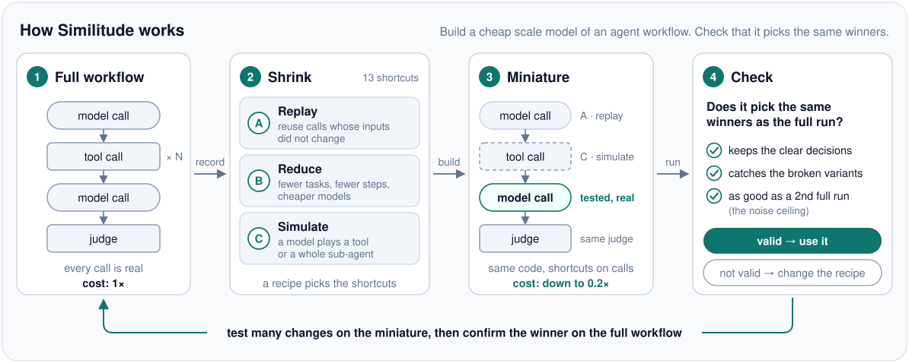

<h1 align="center">Similitude</h1>

<p align="center"><em>Scale Models for Agent Evaluation</em></p>

<p align="center">
  <a href="paper/"></a>
  <a href="LICENSE"></a>
  <a href="#quick-start"></a>
</p>

**The problem.** To choose between two versions of an AI agent (two prompts, two models), teams
run the full workflow on many tasks. This is slow and costly, so they test only a few changes.

**The solution.** Similitude builds a *miniature* of the workflow, like a scale model of a plane in
a wind tunnel: the same code, with cheap shortcuts on its calls. Then it checks that the miniature
picks the same winners as the full evaluation. If it does, you can test many changes for a
fraction of the cost.

<p align="center">
  <picture>
    <source media="(prefers-color-scheme: dark)" srcset="docs/assets/overview-dark.svg">
    
  </picture>
</p>

This repo holds the library, the experiments and the paper *Similitude: Scale Models for Agent
Evaluation* (Harsh Mandalgi, Mohit Chaturvedi, Keshav Likhar; preprint, 2026). The paper source is
in [paper/](paper/).

Status (Oct 2026): experiments finished. Three workflows, sixteen miniatures, about 18,200 runs,
about $75 in API calls (estimated). Plain-English results: [docs/06-RESULTS.md](docs/06-RESULTS.md).

---

## The project in 4W1H

| | |
|---|---|
| **What** | A method + Python library that shrinks an agent workflow into a cheap **mini workflow**. Evals on the mini lead to the **same decisions** as evals on the full workflow. Plus a research paper that tests this. |
| **Why** | Running a full agent workflow for every eval is slow and costly. So teams test few changes. A valid mini at a fraction of the cost (about one fifth in our study) lets you test many. |
| **When** | In the inner loop: trying prompt edits, model swaps, tool changes. The full workflow is still used for the final check. |
| **Where** | Any multi-step LLM workflow with tools: agents, multi-agent systems, pipelines. |
| **How** | Record full runs → shrink with a set of operators (replay, simulated tools, merged calls, …) → check the mini against the full workflow and its noise ceiling → iterate on the mini → confirm on the full. |

## Main results

- **Simulated tools keep decisions when a model can know the answers**: 18–19 of 20 clear
  decisions for a Wikipedia agent, 8 of 8 for a research planner.
- **A quarter of the tasks** costs one fifth of the full evaluation and keeps 85% of the clear
  decisions. **Replay of unchanged steps** costs about one fifth too; our one test of it was
  inconclusive, because the full evaluation was itself mostly noise.
- **The noise ceiling** (the full workflow, run again) shows when the full evaluation itself is
  noise, so a correct mini is not rejected by mistake.
- **Two limits**: merged calls that imagine tool results miss the broken variants, and a
  simulator cannot replace a tool that reads hidden data.

## Is this already out there? (short answer)

- **We found no earlier work that does the full idea.** Pieces exist: smaller test sets, LLM-faked tools, cheap-model
  prompt search, replaying recorded steps.
- **Our gap:** shrink a whole existing workflow, then check that decisions, the judge's reasons,
  and fixes carry back, read against a noise ceiling.
- Details: [docs/01-PRIOR-WORK.md](docs/01-PRIOR-WORK.md) and the paper's related work.

## Read in this order

| Doc | What's in it | Time |
|---|---|---|
| [06-RESULTS.md](docs/06-RESULTS.md) | Which minis keep the evaluation valid, in plain English | 8 min |
| [02-IDEAS.md](docs/02-IDEAS.md) | How to build a mini: operators, 6 rules, validity checks, risks | 12 min |
| [05-IMPLEMENTATION.md](docs/05-IMPLEMENTATION.md) | How the code works, the 3 workflows, models, how to run | 6 min |
| [01-PRIOR-WORK.md](docs/01-PRIOR-WORK.md) | What existed at the start (Oct 2026), the closest papers, our gap | 8 min |
| [03-PLAN.md](docs/03-PLAN.md), [04-PAPER-OUTLINE.md](docs/04-PAPER-OUTLINE.md) | The original research plan and paper outline (planning notes) | 5 min |
| [results/](results/) | Tables per workflow, written by `scripts/run.py <workflow> analyse` and `scripts/summary.py` | – |

## Quick start

Needs Python 3.12+ and [uv](https://docs.astral.sh/uv/). The experiments call paid APIs. Run from
a clone: the task files live in `data/`, outside the Python package.

```bash
git clone https://github.com/harshmandalgi/similitude && cd similitude
uv sync
uv run pytest                                  # offline tests, no API calls
cp .env.example .env                           # then fill in your own keys
gcloud auth application-default login          # for Gemini on Vertex AI
export SIMILITUDE_CAP_USD=2                    # spending cap, checked before every call
uv run python scripts/run.py wikiqa smoke      # base variant, 3 tasks
```

- **Judging** uses the [Claude Code](https://docs.claude.com/en/docs/claude-code) CLI (`claude -p`)
  as a blind judge with no tools. It runs with your local Claude Code login.
- **Spend** is estimated from token counts and list prices and recorded in `runs/ledger.json`.
  The cap is checked before every call and retry; calls already in flight can go slightly over it.
- **Runs** are saved under `runs/` (not in git) and are resumable: a finished run is skipped. A run
  is found by its name only (workflow, recipe, variant, task, replicate), so move `runs/` away after
  you change a prompt, a recipe or a model.
- Full commands: [docs/05-IMPLEMENTATION.md](docs/05-IMPLEMENTATION.md#how-to-run).

## Data and licences

- **Code:** MIT, see [LICENSE](LICENSE). The licences below cover the parts that are not ours.
- **W1 tasks** (`data/wikiqa/tasks.jsonl`): a subset of [HotpotQA](https://hotpotqa.github.io/),
  CC BY-SA 4.0.
- **W3 tasks** (`data/research/tasks.jsonl`): a subset of
  [FRAMES](https://huggingface.co/datasets/google/frames-benchmark), Apache 2.0.
- **W2** (`src/similitude/third_party/tau_retail/`): the retail environment of
  [τ-bench](https://github.com/sierra-research/tau-bench), MIT, vendored with its licence.
- **Variants and fixes** (`data/*/edits.json`, `data/wikiqa/fixes.json`): written by Claude.
- Details and the changes we made: [data/LICENSES.md](data/LICENSES.md). The task subsets keep
  their own licences; the MIT licence does not cover them.
- **Paper template:** `paper/acl.sty` and `paper/acl_natbib.bst` come from the
  [ACL style files](https://github.com/acl-org/acl-style-files), which ACL provides for authors to
  format their papers. `acl_natbib.bst` is under the LaTeX Project Public License; `acl.sty` and
  its source repo state no licence. Neither file is covered by the MIT licence.
- Run traces and raw judge answers are not included.

## Words used in these docs

| Word | Meaning |
|---|---|
| **Workflow** | An agent system: LLM calls + tool calls, in some order. |
| **Full** | The real workflow, unchanged. |
| **Mini** | The cheap, shrunk copy. |
| **Focus** | The part you are changing and testing. Stays real in the mini. |
| **Operator** | One way to shrink (e.g. "replace this tool with an LLM fake"). |
| **Variant** | One version of the focus (e.g. prompt A vs prompt B). |
| **Valid** | The mini leads to the same decision as the full workflow would. |
| **Judge** | An LLM (or rule) that scores a run and explains why. |

## Citation

```bibtex
@misc{mandalgi2026similitude,
  title  = {Similitude: Scale Models for Agent Evaluation},
  author = {Mandalgi, Harsh and Chaturvedi, Mohit and Likhar, Keshav},
  year   = {2026},
  note   = {Preprint}
}
```
